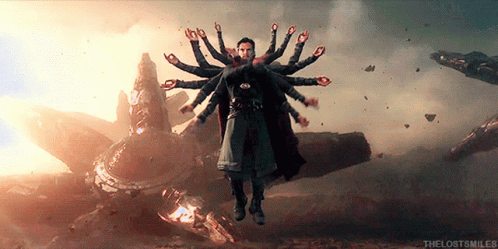
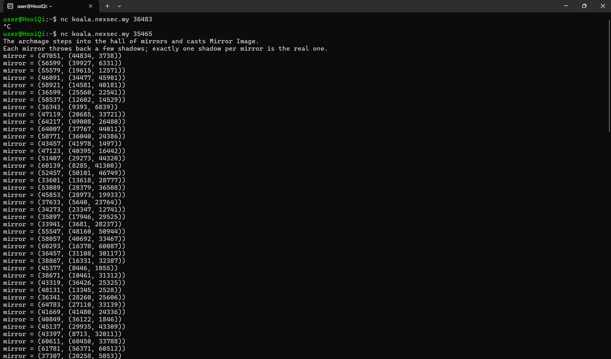
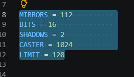
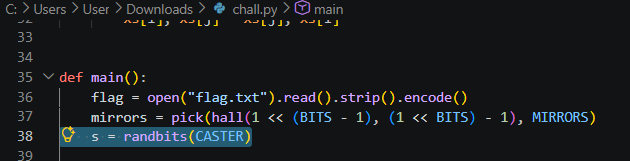
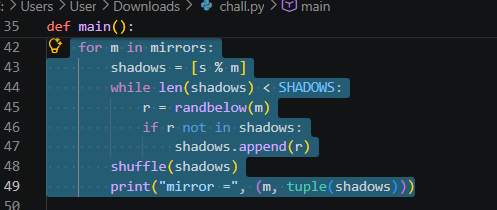
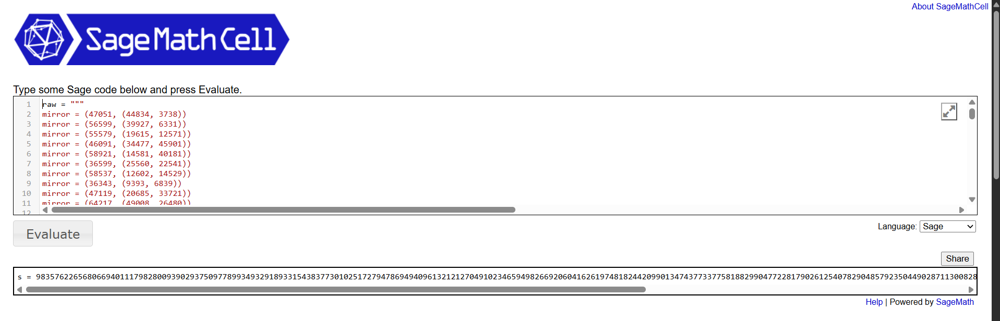
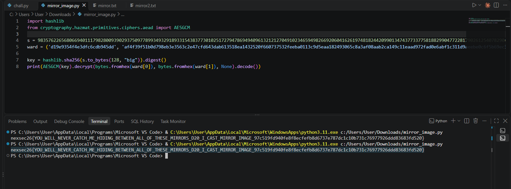
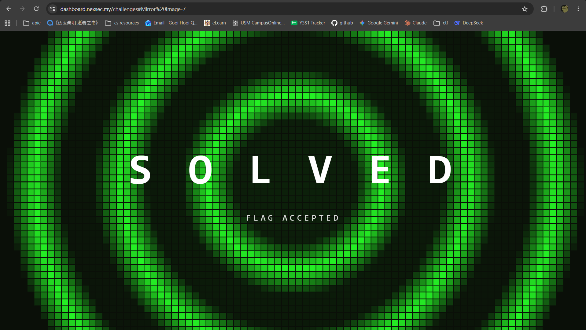

# Mirror Image - NEXSEC CTF 2026

Solved by `hooiqi`

## Description



The archmage knew the party was coming, so he raised a hall of mirrors and vanished into it with a single spell: Mirror Image.
Every mirror on the wall throws back a handful of shadows of him, but only one shadow in each mirror is the real archmage, the rest are illusions. Stare at any one mirror and you cannot tell which is which.

He sealed his escape ward behind his own true form. Catch the caster hiding between all of those mirrors, or let him walk away.

`nc koala.nexsec.my PORT`

(Included file: `chall.py`)

## The Solve

I ran the service with `nc koala.nexsec.my 35465` and saved the output to `mirror.txt`.\
First time it expired so to avoid any risk of old flags I spawn a new instance.



First we check the given `chall.py`, we can get lots of info here:

- **MIRRORS** = 112: there are 112 mirrors.
- **BITS** = 16: each modulus is 16 bits.
- **SHADOWS** = 2: each mirror shows 2 numbers.
- **CASTER** = 1024: the secret s is 1024 bits.
- **LIMIT** = 120: a time limit for the session.



From line 37 and 38, we know that `s = randbits(1024)`, means `s` is 1024 bits long.
The script generated 112 primes each size is 16 bit.



Line 42-49 is the mirror loop.\
For each `m`, the list starts with the real remainder `s % m`. A random different number is added as the decoy, and the pair is shuffled. So for every mirror, exactly one of the two printed numbers equals `s mod m`, and I cannot tell which.



Line 51-53 is how the key formed.\
`s` is written as 128 big-endian bytes, hashed with `SHA-256` into a 32-byte key, and used for `AES-GCM` with a 12-byte `nonce` and no associated data.
The ward output is the `nonce` (hex) and the `ciphertext` with its tag (hex).
Now we know that once we recover `s`, we can derive the key and decrypt.

> **Process of figuring out the type of challenge with Deepseek:**\
> I suspected this was a `CRT-with-noise` problem and proposed `LLL`. DeepSeek confirmed this was feasible but described it as `CRT list decoding` and gave a 113×113 matrix that did not work. I then found reference solutions (Karen, Chimera) and adapted that construction: each mirror gives `s ≡ a_i + e_i(b_i − a_i) mod m_i` with `e_i ∈ {0,1}`, so `s = s0 + Σ e_i·c_i − kM`, and `LLL` finds the short vector `(e_i·W, s, W)`.\
> I then searched for similar challenges and found Karen (*zer0pts CTF 2022*) and Chimera (*HITCON CTF 2022*). Both use LLL on a lattice built from a modulus row plus identity-style rows to recover hidden small or binary vectors.

I borrowed three ideas.\
First, a modulus row plus diagonal rows plus an embedding row.\
Second, a large weight on the diagonal to balance the magnitudes, as in Chimera.\
Third, the post-processing: accept a vector or its negative, and filter by size.

I attempted to install Sagemath in WSL as suggested by Deepseek but failed, so I decided to use `Sage Cell`, an online Sagemath terminal.

Now we start to recover the `s`, SageMath is basically just Python with math superpowers.

`mirror.sage` partial script (core function):

```python
data = [eval(x.split("=")[1].strip()) for x in raw.strip().split("\n") if "mirror" in x]
n = len(data)
ms = [x[0] for x in data]
M = prod(ms)
s0 = crt([x[1][0] for x in data], ms)

W = 2**1024 
mat = Matrix(ZZ, n + 2, n + 2)

for i in range(n):
    mat[i, i] = W
    m, (s1, s2) = data[i]
    diff = (s2 - s1) % m
    Mi = M // m
    mat[i, n] = (diff * Mi * inverse_mod(Mi, m)) % M

mat[n, n] = M
mat[n+1, n+1] = W
mat[n+1, n] = s0
```

Each mirror gives me a modulus `m` and two numbers, and exactly one of them equals `s mod m`. I write the unknown choice as a bit `e_i: s ≡ a_i + e_i·(b_i − a_i) (mod m_i)`, with `e_i = 0` if `a_i` is the real one and `1` if `b_i` is. Guessing 112 bits would take 2^112 tries, so I use CRT to turn all the choices into one equation.

- `M = prod(ms)` is the product of all moduli, about `2^1740`.
- `s0 = crt(first numbers, ms)` is the answer I’d get if every first number were real. It is right for roughly half the mirrors.
- `c_i = diff · M_i · inverse_mod(M_i, m_i) % M`, where `diff = b_i − a_i`. This number is ≡ diff mod m_i and ≡ 0 mod every other modulus, so switching mirror i from a_i to b_i adds exactly c_i and changes nothing else.
- So `s = s0 + Σ e_i·c_i − k·M` for some integer `k`. The `−kM` brings the sum back below `M`.

The matrix encodes this directly:

- Row i `(mat[i,i] = W, mat[i,n] = c_i)` means “switch mirror i”.
- Row n `(mat[n,n] = M)` lets the lattice subtract multiples of M.
- Row n+1 `(mat[n+1,n] = s0, mat[n+1,n+1] = W)` is the starting guess, and the W in the last column marks that it was used exactly once.



```shell
s = 98357622656806694011179828009390293750977899349329189331543837730102517279478694940961321212704910234659498266920604162619748182442099013474377337758188299047722817902612540782904857923504490287113008289241273521823315134023696916975315550695522664209011800407226073173604275552066200448968883071121653916868
```

After getting `s`, we use a python script to decrypt the flag.

The script rebuilds the lock from `chall.py` using the `s` we recovered. It turns `s` into 128 bytes and hashes it with `SHA-256` to get the `AES` key, the same way the challenge did. Then it uses that key, the nonce `(ward[0])`, and the ciphertext `(ward[1])` to decrypt the flag with `AES-GCM`.\
If `s` were wrong, decryption would fail, so a readable flag confirms `s` is correct.

```python
import hashlib
from cryptography.hazmat.primitives.ciphers.aead import AESGCM

s = 98357622656806694011179828009390293750977899349329189331543837730102517279478694940961321212704910234659498266920604162619748182442099013474377337758188299047722817902612540782904857923504490287113008289241273521823315134023696916975315550695522664209011800407226073173604275552066200448968883071121653916868
ward = ('d19e9354f4e3dfc6cdb945dd', 'af4f39f51b0d798eb3e3563c2e47cfd643dab613518ea1432520f660737532feeba0113c9d5eaa182493065c8a3af08aab2ca149c11eaad972fad0e6abf1c311d9aeebe0c6f5b69ec3ea4881a37211162f7c03559081570f8a793ae63f603223960c6b3978975d44d4cd2a8f3743cfb2f81abbbbf2b695e62fea317c5645dac2e2b363001240fbbb497d32072f2450ff1566e9b25e768ed35d58a58087d6a4155eb44c01564e7543926ff5c8c159')

key = hashlib.sha256(s.to_bytes(128, "big")).digest()
print(AESGCM(key).decrypt(bytes.fromhex(ward[0]), bytes.fromhex(ward[1]), None).decode())
```



And we got the flag!!!

`nexsec26{YOU_WILL_NEVER_CATCH_ME_HIDING_BETWEEN_ALL_OF_THESE_MIRRORS_D20_I_CAST_MIRROR_IMAGE_97c519fd940fe8f8ecfefb8d6737e787dc1c10b731c76977926ddd83683fd520}`



---

Reference:\
Karen: [https://github.com/pcw109550/write-up/tree/master/2022/zer0pts/Karen](https://github.com/pcw109550/write-up/tree/master/2022/zer0pts/Karen)\
Chimera: [https://github.com/maple3142/My-CTF-Challenges/blob/master/HITCON%20CTF%202022/Chimera/solve.sage](https://github.com/maple3142/My-CTF-Challenges/blob/master/HITCON%20CTF%202022/Chimera/solve.sage)
