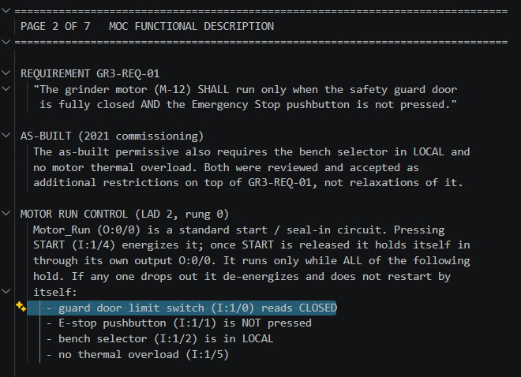
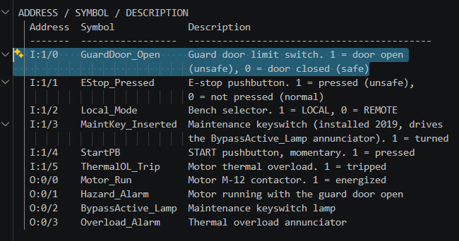
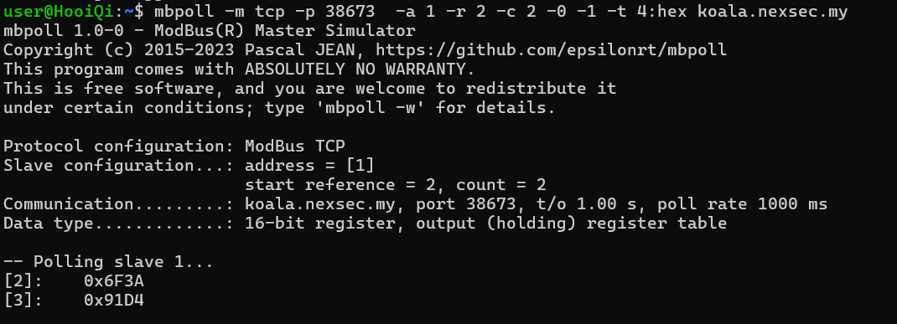
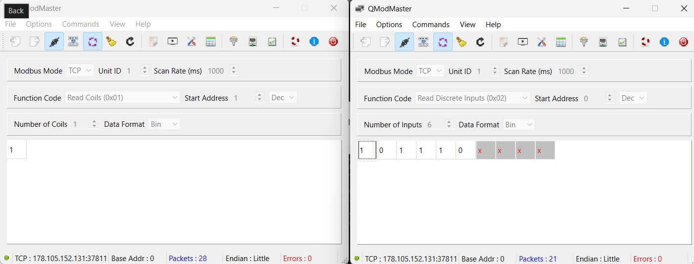

# Lumi the Analyst - NEXSEC CTF 2026

Solved by `hooiqi`

## Description

Enjoy a lil bit of OT knowledge :D

`nc koala.nexsec.my PORT`

(Included files: `Lumi-the-Analyst.zip` -- `grinder_guard_export.txt`, `modbus_point_map.md`, `README.md`)

---
*From `README.md`:*\
Category: OT / ICS (PLC) | Difficulty: Easy

Bench Grinder GR-3's guard door should force the motor off whenever it's open, yet operators swear it doesn't, and they all tell the same story about why. You're Lumi, the analyst! You hold the approved 2021 program baseline and a live Modbus/TCP connection to the running processor. One read proves nothing. Exactly one run-permissive contact (input I:1/x) of the Motor_Run rung differs from the baseline. Find it and prove it from the live system.

**Port:** 502 (Modbus/TCP)
**Files:** `grinder_guard_export.txt`, `modbus_point_map.md`

**Flag format:**

```text
nexsec26{<baseline_instruction>_<baseline_address>_<live_instruction>_<live_address>_<resident_checksum>}
```

Addresses: `:` and `/` become `_` (I:1/4 -> I_1_4).
Example shape (not the real answer): `nexsec26{XIC_I_1_4_XIO_I_1_2_1A2B3C4D}`

## The Solve

According to the story, the factory motor should only run when the safety guard door is securely closed. However, there is a bug in the live system allowing the motor to run while the door is open. We need to find the original safe code (baseline), the broken live code, and a system checksum to build the final flag. The question mentioned the use of mbpoll, indicates that we will use WSL.

Given flag format:

```text
nexsec26{<baseline_instruction>_<baseline_address>_<live_instruction>_<live_address>_<resident_checksum>}
```

Addresses: `:` and `/` become `_` (I:1/4 -> I_1_4).\
Example shape: `nexsec26{XIC_I_1_4_XIO_I_1_2_1A2B3C4D}`

1. Baseline instruction and baseline address: `XIO_I_1_0`

    Page 5 of the archive, which held rung 0 (the Motor_Run rung), is marked NOT RECOVERED, so I could not read the baseline rung directly. I rebuilt it from the other pages.

    Page 2 says the motor runs only while the guard door limit switch (I:1/0) reads closed, along with E-stop not pressed, selector in LOCAL and no thermal overload.

    

    The page 4 symbol table says I:1/0 (GuardDoor_Open) is 1 when the door is open (unsafe) and 0 when it is closed (safe).

    

    So the baseline permissive needs I:1/0 to be 0. In RSLogix 500, XIO (examine if open) is true when its bit is 0, so the baseline contact is XIO I:1/0.

2. Checksum: `6F3A91D4`

    I ran the command to read the holding registers from the server:

    ```bash
    mbpoll -m tcp -p 38673 -a 1 -r 2 -c 2 -1 -t 4:hex koala.nexsec.my
    ```

    Output:

    ```bash
    [2]:    0x6F3A
    [3]:    0x91D4
    ```

    

3. Now we want to find the live instruction and live address.

    To find the changed contact, I had to watch the six input bits and the coil change over time, and see when a bit went from 0 to 1. mbpoll was not convenient for this. QModMaster is a modbus application designed to test and monitor communication network.

    So I used QModMaster and opened two windows at the same time: one reading the six discrete inputs (what the field is doing), and one reading the coil (what the program output does). This let me compare inputs and output side by side.

    I pinged koala.nexsec.my in my command prompt to get its IP address (178.105.152.131).

    - Window 1: Read Coils (0x01), start address 1, 1 coil.
    - Window 2: Read Discrete Inputs (0x02), start address 0, 6 inputs.

    Result: inputs = 1 0 1 1 1 0 and coil address 1 = 1.

    Using the point map, the inputs are:

    | Input | Symbol | Value | Meaning |
    | :---- | :---- | :---- | :---- |
    | 0 (I:1/0) | GuardDoor_Open | 1 | Door open |
    | 1 (I:1/1) | EStop_Pressed | 0 | Not pressed |
    | 2 (I:1/2) | Local_Mode | 1 | LOCAL |
    | 3 (I:1/3) | MaintKey_Inserted | 1 | Key turned |
    | 4 (I:1/4) | StartPB | 1 | START pressed |
    | 5 (I:1/5) | ThermalOL_Trip | 0 | No overload |



E-stop not pressed, LOCAL and no overload all satisfy the baseline, and START was pressed. In the approved program, only the door could stop the motor here.

The replacement can’t be I:1/2 or I:1/4, since those are the LOCAL and START inputs in the same rung.

The archive says the I:1/3 maintenance keyswitch was installed in 2019, and in the approved program it only turns on the BypassActive lamp (rung 2). It is the only input not used in the motor rung. A key that bypasses the door matches what the operators complained about, and the lamp’s name (“Bypass”) points the same way.The live contact is therefore XIC I:1/3.

At first, I mistakenly thought the live instruction was just checking if the door was open (XIC_I_1_0), but that failed. I realized the true cause of the bypass was the maintenance key.

Assemble all the elements,\
First attempt: wrong\
`nexsec26{XIO_I_1_0_XIC_I_1_0_6F3A91D4}`

2nd attempt: correct\
`nexsec26{XIO_I_1_0_XIC_I_1_3_6F3A91D4}`

---

Modbus TCP reference: [https://simplymodbus.ca/learn.html](https://simplymodbus.ca/learn.html)
