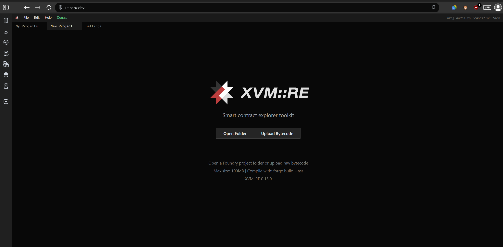
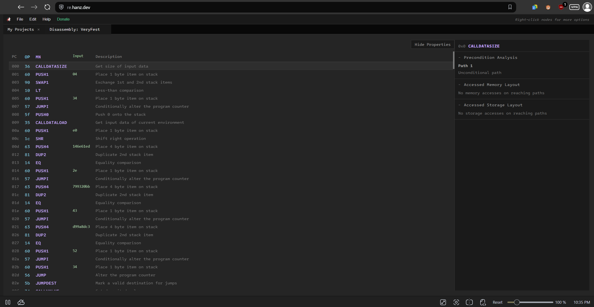
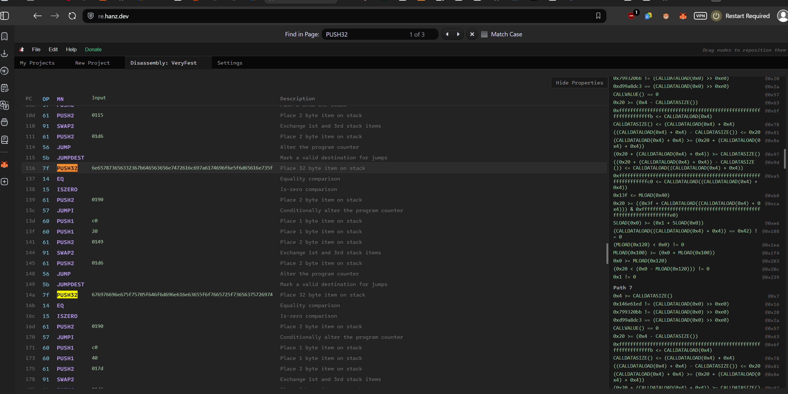
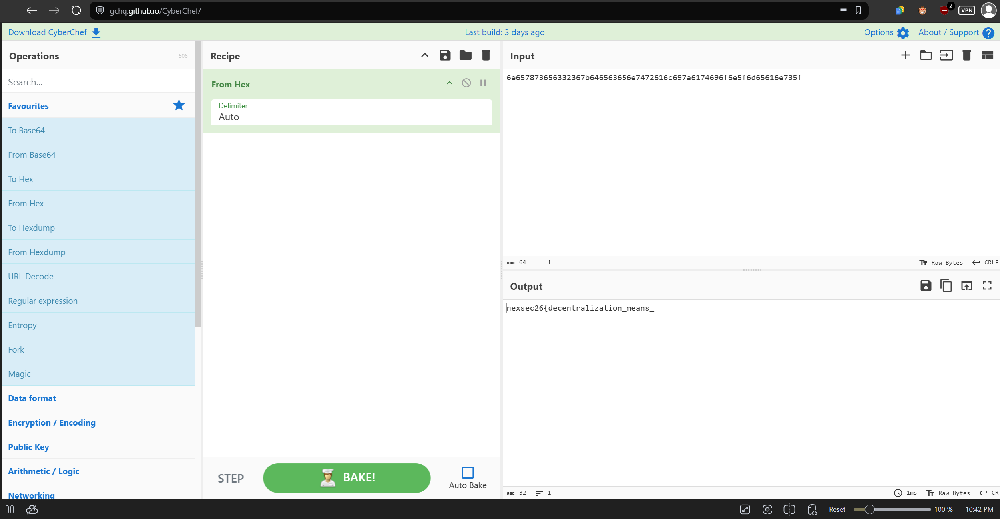
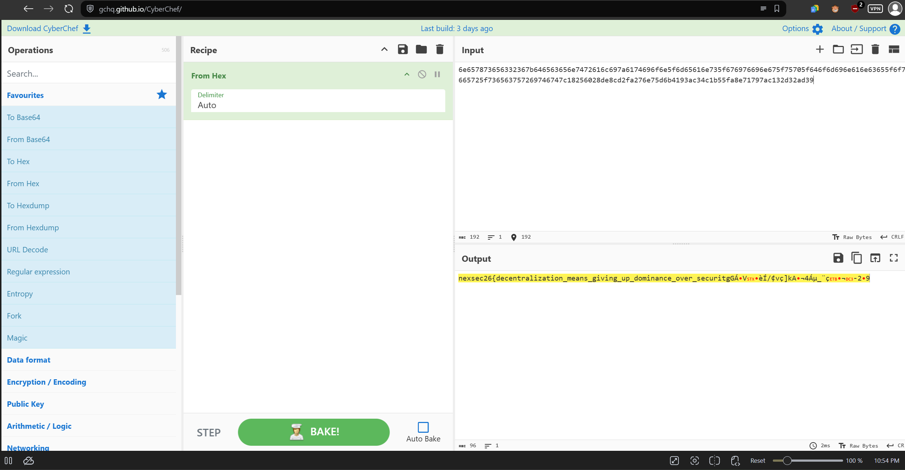

# Very Fest - NEXSEC CTF 2026

Solved by `adrianchx`

## Description

Bytecode analysis made easy (re.hanz.dev)

[re.hanz.dev](https://re.hanz.dev)

## Introduction

Very Fest is a simple decoding challenge pretending to be a blockchain challenge. *Very Fest is very fast.*

Files given are `README.md` and `VeryFest.evm`. A `.evm` file is an Etherium Virtual Machine (EVM) opcode file used for blockchain. [re.hanz.dev](https://re.hanz.dev) is also linked in the description.

## Initial Recon (and also the solve)

First, we look at the files given. The `README.md` itself only contains the line `Bytecode analysis made easy (re.hanz.dev)` as in the description,  so we can disregard it.

Meanwhile, `VeryFest.evm` opens to this:

```bytecode
36600490106034575f3560e01c63146e61ed8114602e5763799320bb811460435763d99a8dc381146052576034565b34156038575b5f5ffd5b5f5460c052602060c0f35b34603457600154151561024956fe5b503460345736600490036020901260345736600435600419811160345760040181811160345780820360201160345780356020820182811061026657808403931061026657918211603457603f198211603457603f8201601f191660405161013f811160bd57506101405b602082036020909210610266575b9081015f905282602001909182375f546001810190811061026657805f559060200160c0528160e0525f610100528161012052906042148015610192575060c05f610115916101d6565b7f6e657873656332367b646563656e7472616c697a6174696f6e5f6d65616e735f14156101905760c06020610149916101d6565b7f676976696e675f75705f646f6d696e616e63655f6f7665725f7365637572697414156101905760c0604061017d916101d6565b61797d60f01b1415610190576001610192565b5f5b80156101cd5760018055339160a052907f6747c18256028de8cd2fa276e75d6b4193ac34c1b55fa8e71797ac132d32ad39602060a0a26101d0565b90505b61024956fe5b606081015160408201519151818410156102285783830192831061026657909101518282039290911061026657602082101561021f579060200360031b90811c901b5f90610232565b90505f90610232565b50505050600160a0515b5f82146102425760018214610247575b905090565bfe5b156102595760016101405261025f565b5f610140525b6020610140f35b634e487b7160e01b5f52601160045260245ffd
```

As mentioned in the description, we have a string of bytecode presumedly for EVM format.

Files opened, I then moved to the website itself. Opening `re.hanz.md` shows this page:



Since it had an upload option, naturally I decided to upload the `VeryFest.evm` file containing the bytecode.

This the page we see after:



Scrolling through the page, I encountered three 32 byte hex strings being pushed by the `PUSH32` opcode.



Out of curiosity, I put the first one into CyberChef:



> *Really shocked me when that came out lmao, coz i was running pip install erever to see if I could get anything else, and I only tried pasting it while I was waiting for kali to boot and download. I didn't actually expect it to be that fast.*

Anyway, since that random paste got me like a part of what looked like the flag, I decided to paste the other two hex strings and voila:



The third one probably was a decoy but the first two gave me the complete flag (albeit with two missing chars), that I tested and got correct. (lowkey thought this was a fake flag considering how easy I got it)

`nexsec26{decentralization_means_giving_up_dominance_over_security}`
