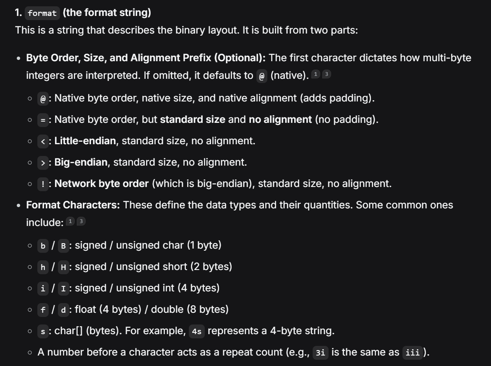
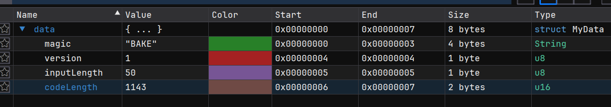
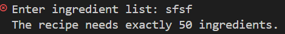
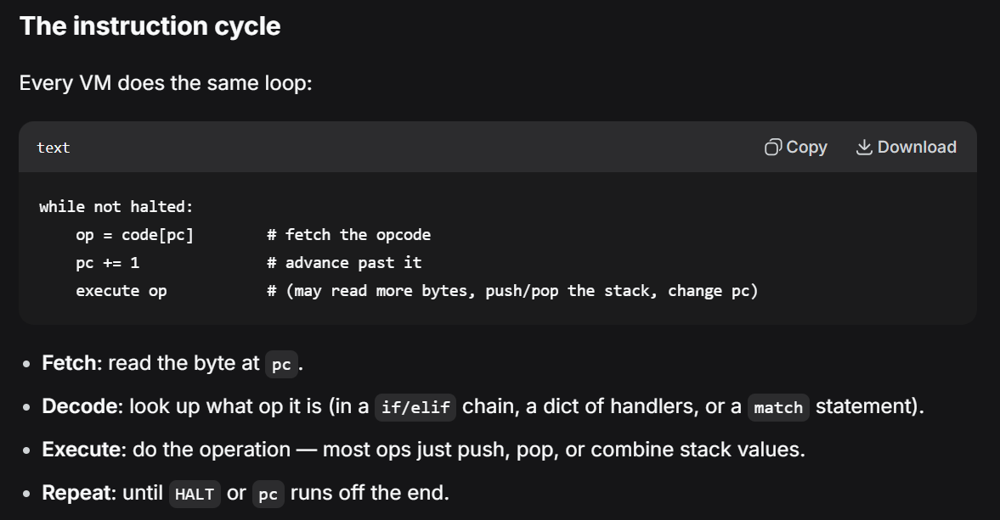
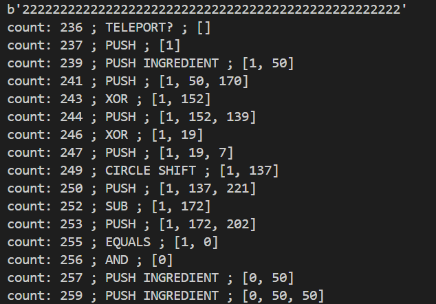
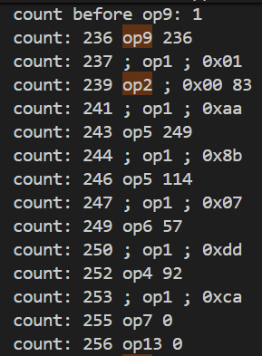
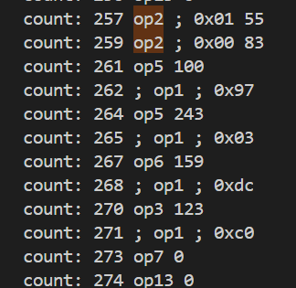
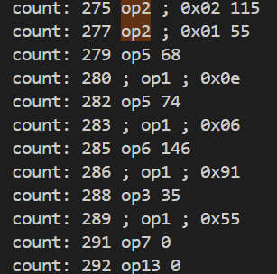

# Bytecode Bakery - NEXSEC CTF 2026

Solved by `adrianchx`

## Description

The bakery's oven runs its own tiny instruction set. The recipe card checks whether you know the secret ingredient list. Find the ingredients that bake a perfect loaf.

> SHA256 of files:\
> oven.py : `161e6c15bf0305132257d5d9f6f1732dca1976afa383d2023df5573266744782`\
> recipe.bin : `ee84b6f469eb82dac886786e28e65e8ea1a3a3436d2778a0e1a54b4b467db4a0`

## Introduction

Bytecode Bakery is a reverse engineering challenge where we're given a python script that acts as a Virtual Machine (VM) to execute bytecode in order to verify an input (the flag) against the program defined in the binary file given. Our goal is to find the valid flag that can be verified with the program.

Files given are `oven.py` and `recipe.bin`. Running `file` on `recipe.bin` tells us it's a simple data file.

## The Journey

(*I'm calling this the journey 'cause it took me like 7 hrs to do— Special thanks to Deepseek for helping me understand all the concepts xd*)

### Initial Recon (and tryna understand what stuff means)

First things first, I looked at the title and description for any obvious keywords. For me, the keywords were 'bytecode' and 'instruction set'.

A quick search and deepseek ask later, we have in short:

- **Instruction Sets (ISA):** The vocabulary of commands a machine (physical or virtual) understands.
- **Bytecode:** An instruction set designed to be executed by a Virtual Machine (VM) rather than directly by hardware. It is compact, portable, and safe.

In our current context, `oven.py` has the instruction set (mentioned in the desc also) while `recipe.bin` is the bytecode.

Moving on from that, we gotta now 'inspect' our 'oven'. In `oven.py` we have two main functions, `load_recipe()` and `bake()`, as well as our `main()`.

Briefly looking at `main()`:

```py
def main():
    here = os.path.dirname(os.path.abspath(__file__))
    path = sys.argv[1] if len(sys.argv) > 1 else os.path.join(here, "recipe.bin")
    try:
        input_len, code = load_recipe(path)
    except (OSError, OvenError) as e:
        print(f"The oven refuses this recipe: {e}")
        return 2

    try:
        text = input("Enter ingredient list: ")
    except EOFError:
        return 1
    ingredients = text.strip().encode("latin-1", "replace")

    if len(ingredients) != input_len:
        print(f"The recipe needs exactly {input_len} ingredients.")
        return 1

    try:
        baked = bake(code, ingredients)
    except OvenError as e:
        print(f"The oven refuses this recipe: {e}")
        return 2
    if baked:
        print("Fresh from the oven! Submit your ingredient list as the flag.")
        return 0
    print("The dough collapsed. Try again.")
    return 1
```

We can see that it calls the `load_recipe()` function to load the data from `recipe.bin`, then prompts the user for an input (presumedly the flag) with a fixed length. The input then gets 'baked' with the bytecode from `recipe.bin` (hence the name Bytecode Bakery), which verifies the input.

Now, we take a look at `load_recipe()`.

```py
def load_recipe(path):
    blob = open(path, "rb").read()
    if len(blob) < 8 or blob[:4] != MAGIC:
        raise OvenError("not a recipe file")
    version, input_len, code_len = struct.unpack("<BBH", blob[4:8])
    if version != 1:
        raise OvenError("unsupported recipe version")
    code = blob[8:8 + code_len]
    if len(code) != code_len:
        raise OvenError("truncated recipe")
    return input_len, code
```

Basically, this function opens the binary file and reads it as raw bytes.

```py
version, input_len, code_len = struct.unpack("<BBH", blob[4:8])
```

This line is used for defining the header. What `<BBH` means here is the formatting for the header:

- `<` is little-endian.
- `B` is an unsigned char (1 byte).
- `H` is an unsigned short (2 bytes).



Putting this all into `ImHex` (`xxd` works too, but I'm using `ImHex` for better visualisation later, also `ImHex` helps with little endian conversion too as you'll see below):



```c++
#pragma endian little
struct MyData {
    char magic[4];
    u8 version;
    u8 inputLength;
    u16 codeLength;
};

MyData data @ 0x00;
```

*(also `magic` here is for the `magic bytes`, which matches the `MAGIC` constant in `oven.py`, it's used to identify or verify the content of a file)*

We get `inputLength = 50` (that you can verify when you randomly input a flag that isn't 50 bytes long) and `codeLength = 1143` (which probably refers to the `recipe` or `bytecode`).



After that, `code` takes the binary bytes after the header until the end of the file (which happens to be `8 + codelength` and matches the python script line `code = blob[8:8 + code_len]`). This is our main recipe used later.

Finally, we move on to `bake()`:

```py
def bake(code, ingredients):
    stack = []
    pc = 0
    try:
        for _ in range(MAX_STEPS):
            if not 0 <= pc < len(code):
                raise OvenError(f"the recipe runs off the end at {pc:#06x}")
            op = code[pc]
            pc += 1

            if op == 0x01:
                stack.append(code[pc])  # PUSH
                pc += 1
            elif op == 0x02:
                stack.append(ingredients[code[pc]]) # PUSH INGREDIENT
                pc += 1
            elif op == 0x03:
                b, a = stack.pop(), stack.pop() # ADD
                stack.append((a + b) & 0xFF)
            elif op == 0x04:
                b, a = stack.pop(), stack.pop() # SUB
                stack.append((a - b) & 0xFF)
            elif op == 0x05:
                b, a = stack.pop(), stack.pop() # XOR
                stack.append(a ^ b)
            elif op == 0x06:
                n, v = stack.pop() & 7, stack.pop() # CIRCULAR ROTATE
                stack.append(((v << n) | (v >> (8 - n))) & 0xFF)
            elif op == 0x07:
                b, a = stack.pop(), stack.pop() # COMPARE
                stack.append(1 if a == b else 0)
            elif op == 0x08:
                target = code[pc] | (code[pc + 1] << 8) # JNZ (JUMP IF NOT ZERO)
                pc += 2
                if stack.pop() != 0:
                    pc = target
            elif op == 0x09: 
                pc = code[pc] | (code[pc + 1] << 8) # JUMP (TELEPORT)
            elif op == 0x0A: 
                return False # WRONG FLAG
            elif op == 0x0B:
                return True  # CORRECT FLAG
            elif op == 0x0C:
                stack.append(stack[-1]) # DUPE
            elif op == 0x0D:
                b, a = stack.pop(), stack.pop() # AND
                stack.append(a & b)
            else:
                raise OvenError(f"unknown opcode {op:#04x} at {pc - 1:#06x}")
    except IndexError:
        raise OvenError(f"malformed recipe near {pc - 1:#06x}") from None
    raise OvenError("the oven overheated (step limit)")
```

I added the comments for easier understanding, but this essentially is a stack Virtual Machine (VM) with a mapping of opcodes. For example, `0x01` is `PUSH` while `0x03` is `ADD`  etc.

Expanding a little bit on the stack VM, a **stack VM** is an interpreter that executes bytecode using a **stack** as its only place to hold intermediate values. Instead of "load register 3, add register 5," instructions *push* and *pop* values on a stack. It's the model used by the JVM, CPython, EVM, and most textbook bytecode machines. (According to Deepseek)

Like in `oven.py`, the `stack []` array variable holds the values being computed, while `pc` (program counter) holds the index of the next byte to execute.



> *Since I didn't actually know what I was looking at at first, I asked what a simple opcode generation simulation would look like in python, it gave me an examples including a stack VM, which looks nearly identical to what we have in `bake()` but simpler, and thus giving me a direction to go off of.*

---

### Further Recon (actually running the .py now)

Now back to our solve, to better see the program running, I put in a line `print("count:",pc,"; {OP NAME} ;", stack)` for each op here, where `OP NAME` is `ADD`, `PUSH`, etc.

The output looked like this (first line is me printing out the input I entered, I also cleaned up the print messages here for better understanding):



With a randomly generated 50 char long input, I noticed something weird, and also a pattern reccuring throughout the program.

The count should start from 1, but here it directly jumps to 236 (sus). Everything else after this is in sequence so I checked the binary file, where I noticed the bytes after the header: `09 EC`.  First command executed is the `JUMP` (`0x09` in the stack VM) command (hence the `TELEPORT?` print msg), jumping forward to 236 (decimal value of `EC`).

This means everything before that can be skipped when we look at the binary. (kinda, i'll explain more in the solve script)

(Using screenshots taken during the solve, this was what i saw during the solve:)

  

The pattern here seems to be a repeating sequence of ops `[2, 2, 5, 5, 6, 3/4, 7, 13]`, converting it into text is `PUSH INPUT` (x2), `XOR` (x2), `CIRCULAR SHIFT` (x1), `SUB` or `ADD` (x1), `EQ COMPARE` and `AND`.

In human terms and my understanding:

- it takes 2 chars from the input (in sequence),
- `XOR`s them together, `XOR`s again with a fixed value from the **bytecode**,
- circular shift (fixed key from the **bytecode**),
- `SUB` or `ADD` a fixed value from **bytecode**,
- `EQUAL` it with a fixed value from **bytecode** (this returns 1 or 0 for true/false) to check if it's the correct char,
- then the `AND` makes sure each char in the flag is correct by `AND`ing the prev flag char result with the current flag char result (so that you can't cheese with only the last char correct, it has to be the entire string).

Notice that 'fixed value from **bytecode**' keeps repeating, this means that we can reverse the entire sequence using these values.

---

### The Solve (finally)

After many trials and errors, this was the python script I created *(read: modifying the original file until stuff works)* for the solve.

`solve.py`

```py
import os
import struct
import sys

MAGIC = b"BAKE" #66 65 75 69
MAX_STEPS = 100_000 #100 000 times


class OvenError(Exception):
    pass


def load_recipe(path):
    blob = open(path, "rb").read() 
    if len(blob) < 8 or blob[:4] != MAGIC: 
        raise OvenError("not a recipe file")
    version, input_len, code_len = struct.unpack("<BBH", blob[4:8]) # version 1, input 50, code len: 1143
    if version != 1:
        raise OvenError("unsupported recipe version")
    code = blob[8:8 + code_len]
    REVcode = code[::-1] # reverse entire bytecode so we start from the back
    if len(code) != code_len:
        raise OvenError("truncated recipe")
    # print(REVcode)
    return input_len, REVcode[5:] # shave the opcode bytes used for verifying the flag


def unbake(code):
    stack = []
    addOrsub = 0
    numReversedOp = 0
    pc = 0
    loop = 0
    print(code)
    try:
        for _ in range(MAX_STEPS):
            if not 0 <= pc < len(code):
                raise OvenError(f"the recipe runs off the end at {pc:#06x}")
            op = code[pc]
            pc += 1

            if numReversedOp in (2,5,8,11,14,16,18): # values pushed, we skip these when in reverse order
                if numReversedOp == 18: # end of sequence for one char
                    loop+=1
                    numReversedOp = 0
                numReversedOp += 1
                continue

            if loop == 50:
                print("LOOPED 50 TIMES")
                break

            if op == 0x01:
                print("count:",pc,"; num:", numReversedOp, "; prev push:",code[pc-2], "curr push:", code[pc-1])
                stack.append(code[pc-2]) # PUSH

                if numReversedOp == 6: # REVERSE ADD/SUB
                    print("addorsub:" ,addOrsub)
                    if addOrsub == 0: 
                        b, a = stack.pop(), stack.pop() # REVERSE SUB
                        stack.append((a + b) & 0xFF)
                    else:
                        b, a = stack.pop(), stack.pop() # REVERSE ADD
                        stack.append((a - b) & 0xFF)

                elif (numReversedOp == 9): # REVERSE CIRCLE
                    n, v = stack.pop() & 7, stack.pop()
                    print(n, v)
                    stack.append(((v << (8 - n)) | (v >> n)) & 0xFF) 

                elif ((numReversedOp == 12)): # XOR
                    b, a = stack.pop(), stack.pop()
                    stack.append(a ^ b)
                    
                numReversedOp += 1
                print(stack)
            
            elif op == 0x02:
                # stack.append(ingredients[code[pc]]) # PUSH INPUT
                numReversedOp+=1
                print("count:",pc," ; num:",numReversedOp,"; PUSH INGREDIENT ;")
            
            elif op == 0x03:
                # b, a = stack.pop(), stack.pop() # ADD
                # stack.append((a + b) & 0xFF)
                addOrsub = 1
                numReversedOp += 1
                print("count:",pc," ; num:",numReversedOp,"; ADD ;")
            
            elif op == 0x04:
                # b, a = stack.pop(), stack.pop() # SUB
                # stack.append((a - b) & 0xFF) 
                addOrsub = 0
                numReversedOp += 1
                print("count:",pc," ; num:",numReversedOp,"; SUB ;")
            
            elif op == 0x05:
                # b, a = stack.pop(), stack.pop() # XOR
                # stack.append(a ^ b)

                numReversedOp += 1
                print("count:",pc," ; num:",numReversedOp,"; XOR ;")
            
            elif op == 0x06:
                # n, v = stack.pop() & 7, stack.pop() #CIRCLE UNSHIFT
                # stack.append(((v << n) | (v >> (8 - n)) & 0xFF) 
                numReversedOp += 1
                print("count:",pc," ; num:",numReversedOp,"; CIRCLE SHIFT ;")
            
            elif op == 0x07:
                # b, a = stack.pop(), stack.pop() #EQUAL
                # stack.append(1 if a == b else 0)
                numReversedOp += 1
                print("count:",pc," ; num:",numReversedOp,"; EQUALS ;")
            
            elif op == 0x08:
                # target = code[pc] | (code[pc + 1] << 8) # JNZ (JUMP IF NOT ZERO)
                # pc += 2
                # if stack.pop() != 0:
                #     pc = target

                print("count:",pc," ; num:",numReversedOp,"; JUMP IF NOT XERO ")
            
            elif op == 0x09:
                print("count before op9:",pc)  
                # pc = code[pc] | (code[pc + 1] << 8)
                print("count:",pc," ; num:",numReversedOp,"; TELEPORT? ;")
                print (stack)
                return False
            
            elif op == 0x0A:
                print("count:",pc," ; num:",numReversedOp,"op10 wrong input")
                # return False
            
            elif op == 0x0B:
                print("count:",pc," ; num:",numReversedOp,"op11 corek")
                # return True
            
            elif op == 0x0C:
                stack.append(stack[-1]) # DUP
                print("count:",pc," ; num:",numReversedOp,"; DUPE ;") 
                
            elif op == 0x0D:
                # b, a = stack.pop().pop() # AND
                # stack.append(a & b)
                numReversedOp += 1
                print("count:",pc," ; num:",numReversedOp,"; AND ;") 
            else:
                # raise OvenError(f"unknown opcode {op:#04x} at {pc - 1:#06x}")
                pass
    except IndexError:
        raise OvenError(f"malformed recipe near {pc - 1:#06x}") from None
    raise OvenError("the oven overheated (step limit)")


def main():
    here = os.path.dirname(os.path.abspath(__file__))
    path = sys.argv[1] if len(sys.argv) > 1 else os.path.join(here, "recipe.bin")
    try:
        input_len, code = load_recipe(path)
    except (OSError, OvenError) as e:
        print(f"The oven refuses this recipe: {e}")
        return 2

    # try:
    #     text = input("Enter ingredient list: ")
    # except EOFError:
    #     return 1
    # ingredients = text.strip().encode("latin-1", "replace")

    # if len(ingredients) != input_len:
    #     print(f"The recipe needs exactly {input_len} ingredients.")
    #     return 1

    try:
        unbaked = unbake(code)
    except OvenError as e:
        print(f"The oven refuses this recipe: {e}")
        return 2
    if unbaked:
        print("Fresh from the oven! Submit your ingredient list as the flag.")
        return 0
    print("The dough collapsed. Try again.")
    return 1


if __name__ == "__main__":
    sys.exit(main())
```

To summarise my 5 hours of pain (first 2 was just learning phase): I basically hardcoded the reverse sequence, reversed the bytecode and ran it through the reversing sequence.

The result obtained is:

```shell
[64, 0, 108, 52, 83, 124, 18, 2, 5, 27, 60, 39, 59, 87, 74, 11, 20, 57, 43, 68, 94, 49, 59, 87, 88, 95, 86, 61, 106, 92, 54, 108, 71, 13, 27, 61, 106, 4, 89, 28, 15, 77, 4, 81, 6, 22, 11, 29, 11, 196, 170]
```

However, this isn't the actual flag even if you convert it into ASCII chars.

Notice that the reverse sequence stops at only 1 XOR instead of 2? This is because the other XOR needs the decoded value from the previous flag char, which we don't have when reversing from the back. The output we have here is the reversed flag after the first XOR.

Since the first flag char is `XOR`ed with a fixed byte from the bytecode (coz you can't XOR it with a nonexisting prev char since it's first), we can reverse the array and restart the XOR sequence.

Here's the script used for the XOR:

`decoded.py`

```python
data = [11, 29, 11, 22, 6, 81, 4, 77, 15, 28, 89, 4, 106, 61, 27, 13, 71, 108, 54, 92, 106, 61, 86, 95, 88, 87, 59, 49, 94, 68, 43, 57, 20, 11, 74, 87, 59, 39, 60, 27, 5, 2, 18, 124, 83, 52, 108, 0, 64]

start_value = 110 # we get this from 169 XOR 170 (value from bytecode)
decrypted = [110]

# The first step: Start value XOR First byte
current_xor = start_value ^ data[0]
decrypted.append(current_xor)

# The rest of the chain: Current byte XOR Previous Decrypted byte
for i in range(1, len(data)):
    current_xor = decrypted[-1] ^ data[i]
    decrypted.append(current_xor)

print(decrypted)

print(bytes(decrypted).decode())
```

output:

```shell
[110, 101, 120, 115, 101, 99, 50, 54, 123, 116, 104, 49, 53, 95, 98, 121, 116, 51, 95, 105, 53, 95, 98, 52, 107, 51, 100, 95, 110, 48, 116, 95, 102, 114, 121, 51, 100, 95, 120, 68, 95, 90, 88, 74, 54, 101, 81, 61, 61, 125]
nexsec26{th15_byt3_i5_b4k3d_n0t_fry3d_xD_ZXJ6eQ==}
```

`nexsec26{th15_byt3_i5_b4k3d_n0t_fry3d_xD_ZXJ6eQ==}`

---
> *Fun fact, I tried getting Deepseek to give me a 50 char string for testing the input, somehow it attempted like 5 times and kept truncating them so it gave me py script to generate my own random string haha. It was hilarious.*
