# Flag Checker - NEXSEC CTF 2026

Solved by `Selina`

## Description

My friend just downloaded GTA FLAGCHECKER VI for his new PlayStation 5 Pro. The game asks for a password upon initial launch. Find the correct password!!

> Zip Password: 1f315b89b575d6cf8cdf093a6184a956

(Included files: `flagchecker.zip`)

## The Solve

In the flagchecker folder, we are given an `eboot.bin`, which is typically the main executable file of a PS5 application. I first checked the file type using `file`.

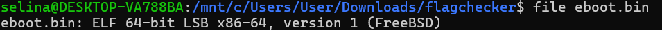

Since the file was recognized as an ELF executable, I proceeded with static analysis using `readelf`.

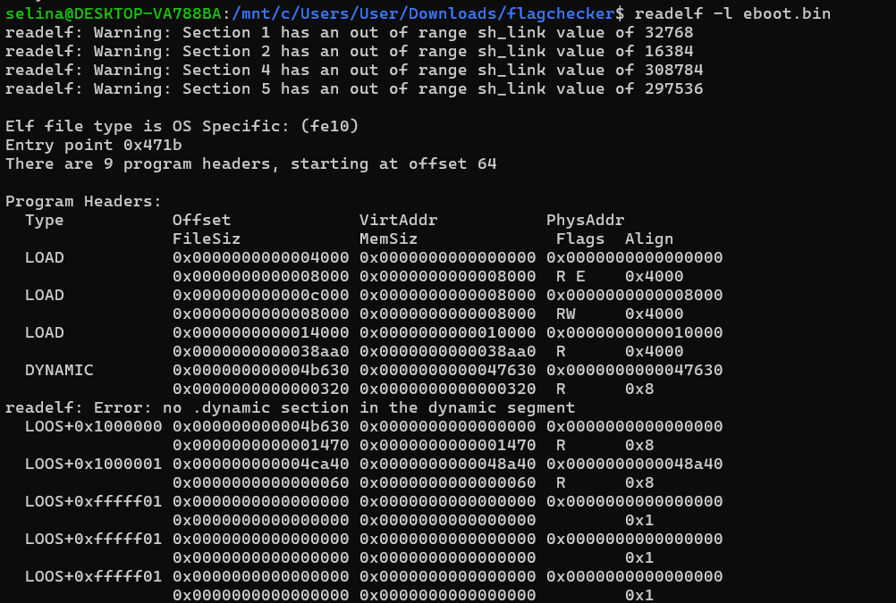

Because it's a FreeBSD ELF with non-standard sections (triggering `readelf` warnings), I looked at the LOAD segments. I identified an executable segment (`R E`) with File Offset `0x4000`, Virtual Address `0`, and Size `0x8000`.

To bypass the section header issues and analyze the executable code directly, I extracted the raw code segment using dd.

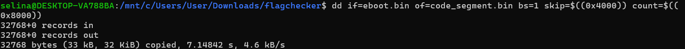

Then, I disassembled it as raw x86-64 binary using `objdump`.

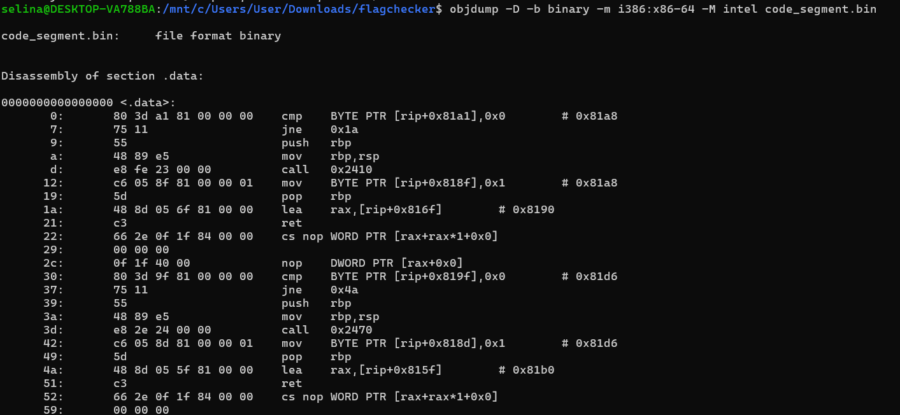

Looking at the beginning of the disassembly, the entry point of the flag checker seems to start at offset `0xf0`. The first few lines clearly define the input validation.

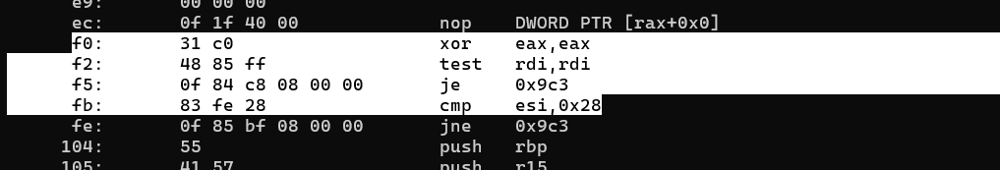

- `xor eax,eax`: Clears eax, setting the default return value to 0 (False).
- `test rdi,rdi` / `je 0x9c3`: Checks if the input pointer (rdi) is NULL. If it is, jump to the cleanup and return 0.
- `cmp esi,0x28` / `jne 0x9c3`: Checks if the input length (esi) is exactly 0x28 (40 bytes).

Starting at `0x115`, the code loads bytes from the input `([rdi + offset])` and performs various arithmetic operations (XOR, ADD, MUL, OR, AND) before comparing the result against a hardcoded constant using `cmp` and `jne 0x9b2`.

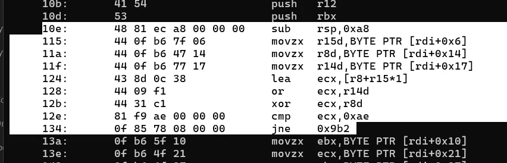

- At `0x115`: `movzx r15d,[rdi+0x6]` sets r15 = `b[6]`.
- At `0x11a`: `movzx r8d,[rdi+0x14]` sets r8 = `b[0x14]`.
- At `0x11f`: `movzx r14d,[rdi+0x17]` sets r14 = `b[0x17]`.
- At `0x124`: `lea ecx,[r8+r15*1]` -> ecx = `b[0x14] + b[6]`.
- At `0x128`: `or ecx,r14d` -> ecx = `(b[0x14] + b[6]) | b[0x17]`.
- At `0x12b`: `xor ecx,r8d` -> ecx = `((b[0x14] + b[6]) | b[0x17]) ^ b[0x14]`.
- At `0x12e`: `cmp ecx,0xae` -> Constraint 1: `((b[0x14] + b[6]) | b[0x17]) ^ b[0x14] == 0xae`.

I repeated this process for all 65 checks in the function.

After adding all 65 constraints into Z3, the solver returned unsat.

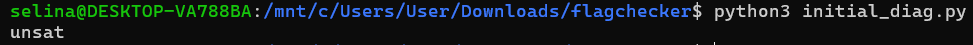

I used `assert_and_track()` to label each constraint and `unsat_core()` to identify a set of conflicting constraints.

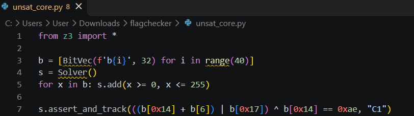

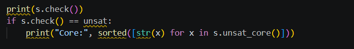

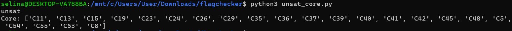

**C8 (r12)**\
Initially, I used `b[0x1a]` for r12, but the following instructions showed that its value had changed:

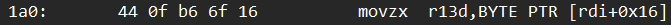\
Loads `b[0x16]` into r13.

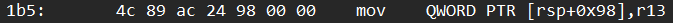\
Saves `b[0x16]` to the stack.

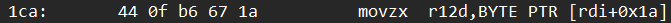\
Loads `b[0x1a]` into r12.

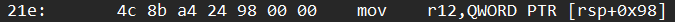\
Overwrites r12 with the saved `b[0x16]`.

Therefore, when C8 is checked at `0x272`, r12 contains `b[0x16]`, not `b[0x1a]`.
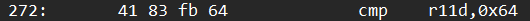

Corrected C8:
`(((b[0x23] * b[0xe]) | b[9]) & b[0x16]) == 0x64`

**C29 (r13)**\
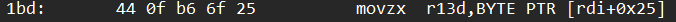\
Initially loads `b[0x25]` into r13

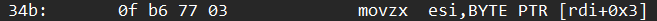\
Loads `b[3]` into rsi.

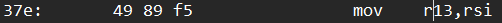\
Overwrites r13 with `b[3]`.

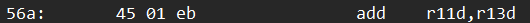\
Uses the updated r13 in C29.

This means C29 should use `b[3]` instead of `b[0x25]`.

Corrected C29:
`((((b[0x1f] * b[0xa]) ^ b[0x1e]) + b[0x3]) == 0x16dc)`

While reviewing the related register and stack values, I found similar errors in other constraints. In total, I corrected eight constraints: C8, C16, C18, C21, C29, C39, C45 and C49.

After updating them, I ran the solver again.

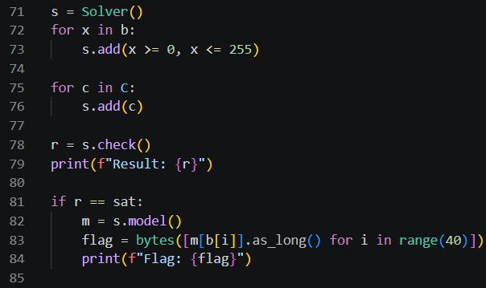

I first limited each variable to the range 0–255, so that each value could fit into one byte.

Next, I added each constraint from C using `s.add(c)` and called `s.check()`. This asks Z3 to find values for the 40 input bytes that satisfy all 65 checks together.

I used `s.model()` to get the values it found. For each position, `m[b[i]].as_long()` converts the value into a Python `integer`. Finally, I collected these values in order with `bytes(...)` and printed the flag.

Returned sat and successfully output the flag.

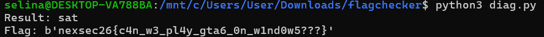

`nexsec26{c4n_w3_pl4y_gta6_0n_w1nd0w5???}`
